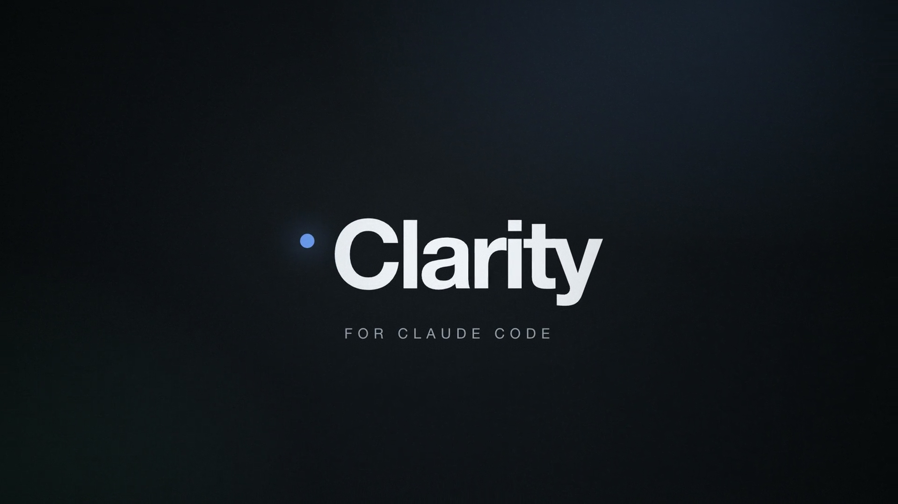
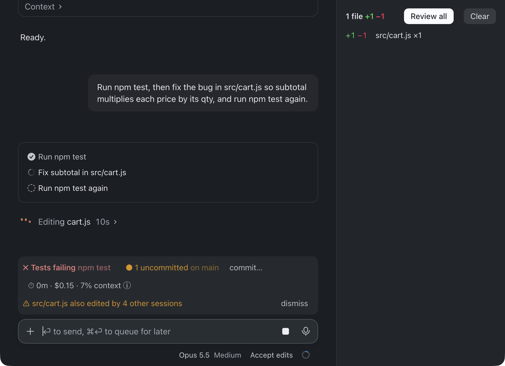
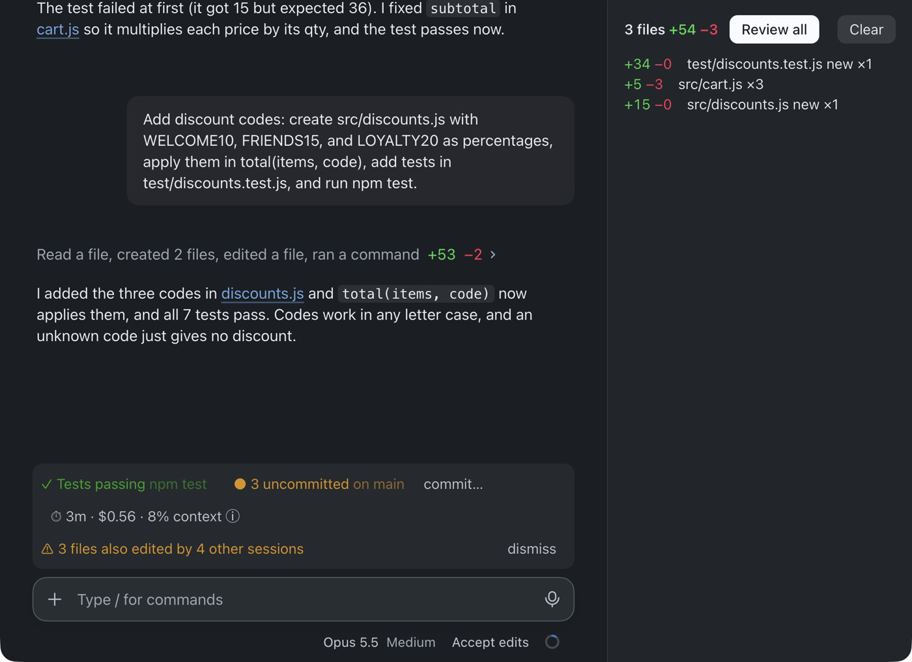
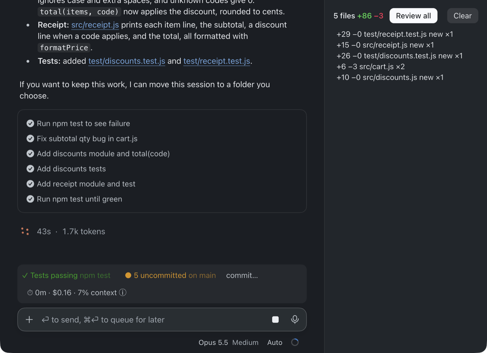

# Clarity

**Clarity for Claude Code**: a theme and three plugins, built for getting work done.
Legible text, status colors you can't misread, surfaces that stay calm over a long
session, and tools that stay quiet until something needs you.

[](docs/clarity-launch.mp4)

<sub>▶ [Watch the 33-second tour](docs/clarity-launch.mp4): real footage of a Claude Code session with Clarity installed.</sub>

| A test fails | Every file Claude touched | Green, and what's left to commit |
| --- | --- | --- |
|  |  |  |

## Install everything in one command

```bash
npx github:swperb/clarity
```

A picker opens with everything checked. Press Enter to install it all, or uncheck what you
don't want first (↑/↓ or j/k move, space toggles, `a` all, `n` none). Then start a new
Claude Code session.

**Change your picks later** with the same picker. It shows what's installed; unchecking
disables a plugin (its data is kept), checking turns it back on:

```bash
npx github:swperb/clarity config
```

For scripts and dotfiles:

```bash
npx github:swperb/clarity --all --yes
```

```bash
npx github:swperb/clarity --only clarity-theme,workbench --scope project
```

`--list` shows what's available and installed, `--dry-run` prints the `claude plugin`
commands without running them, and `--remove` uninstalls what you uncheck instead of
disabling it. The installer needs Node 18+ and Claude Code; it has no dependencies and
only runs `claude plugin …` commands you could run yourself.

## What's in the suite

| | What it's for |
| --- | --- |
| [**Clarity theme**](themes/clarity-theme) · theme | High legibility, colorblind-safe status colors, standard diff colors, strong keyboard focus rings. Light and dark. |
| [**Workbench**](plugins/workbench) · plugin | An attention band for failing tests, uncommitted work and a filling context window; a guard that asks before hard-to-undo commands; a changed-files pane; a usage chip that explains time, cost and context when clicked. |
| [**Factory**](plugins/factory) · plugin | One control room for many sessions across many projects: a factory-floor pane, a needs-you queue with one batched notification, a per-project color tint, and a radar for two sessions editing the same file. |
| [**Studio**](plugins/studio) · plugin | A soft IDE beside the chat: the session folder's file tree and a live viewer that follows what Claude reads, edits, searches and runs, with an activity strip. |

Each plugin also has its own in-session settings, for example `/workbench guard off` or `/studio auto off`.

## Install one at a time

At the prompt of a Claude Code terminal session:

```
/plugin install clarity-theme --marketplace swperb/clarity
```

Answer `y` to add the marketplace, then pick a scope (user scope applies it everywhere).

From a shell:

```bash
claude plugin install workbench --marketplace swperb/clarity
```

In the desktop app: click **+** next to the prompt box → **Plugins** → **Add marketplace**
with `swperb/clarity` → **Add plugin**.

Themes apply to the desktop and mobile apps; terminals and editors keep their own colors.

## What every theme here must do

Looking good is the easy part. A theme in this repo also has to:

1. **Keep words readable.** Primary text at 7:1 contrast or better on every surface;
   muted text at 4.5:1 or better.
2. **Keep meaning.** Danger reads as red, success as green, warning as amber, and they
   stay distinguishable for people with color-vision deficiency (differ in lightness,
   not just hue).
3. **Leave diffs alone.** Added/removed lines keep the app's standard green and red:
   everyone reads them instantly, so a theme doesn't override `git` colors.
4. **Work in both light and dark**, unless the idea only makes sense in one.
5. **Not trip the app's own checks.** `makeColors` reports contrast problems; no line
   may start with `Desktop won't paint`, or the app ignores the theme.

## Add a theme or plugin

1. Copy `themes/clarity-theme` (or `plugins/workbench`) to a new folder and rename it in its `.claude-plugin/plugin.json`.
2. For a theme, edit the colors in `hooks/palette.js` and leave `make-colors.js` as it is.
   Check contrast: `node -e "import('./themes/<your-theme>/hooks/palette.js').then(m => console.log(m.clarity().problems.join('\n')))"`
3. Validate: `claude plugin validate <folder>`
4. Add an entry to `.claude-plugin/marketplace.json` and a row to the table above.
   The installer picks up new entries on its own.
5. Run the installer's tests: `npm test`.

## License

MIT
