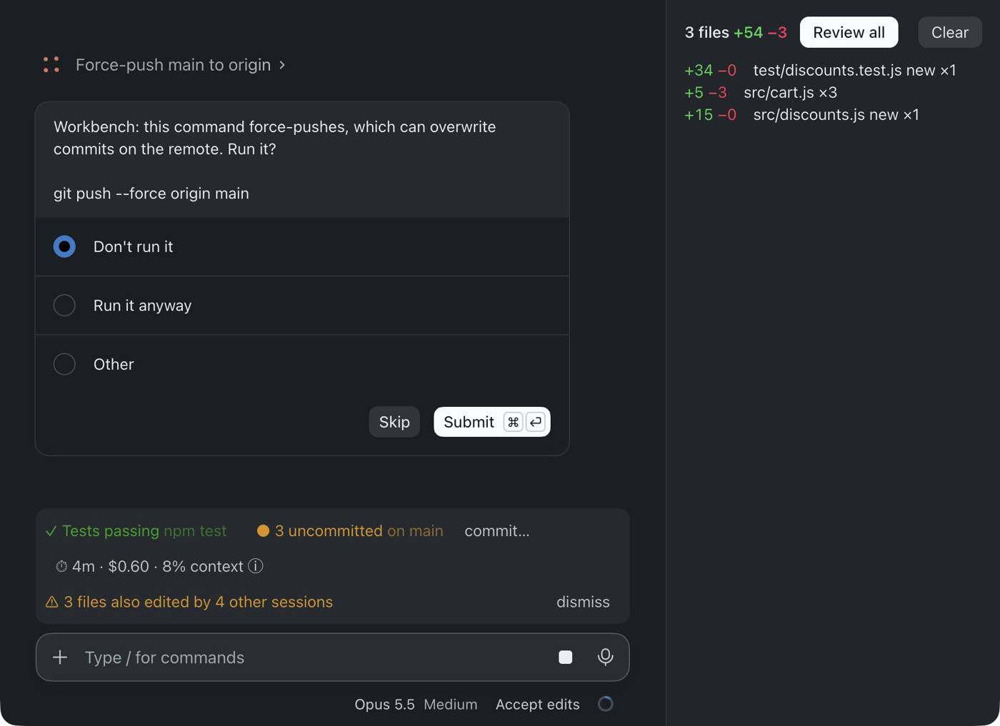
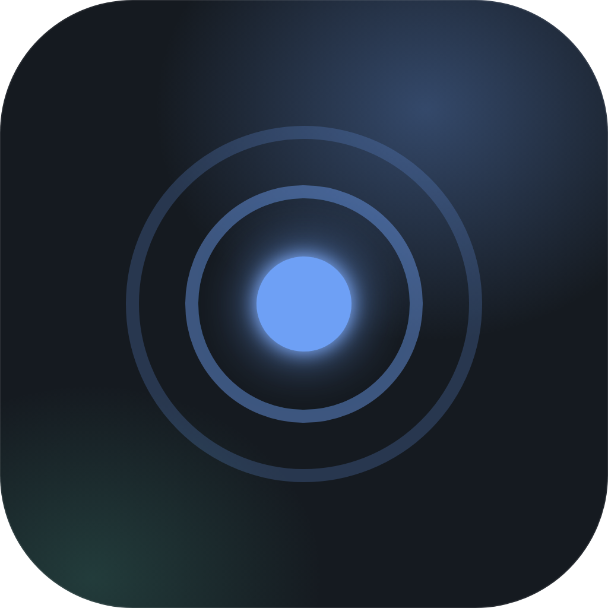
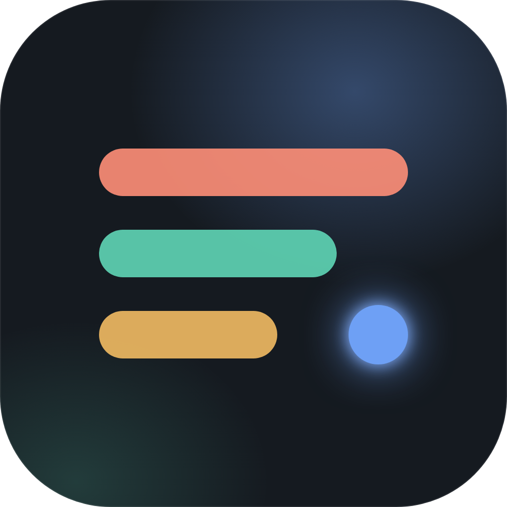
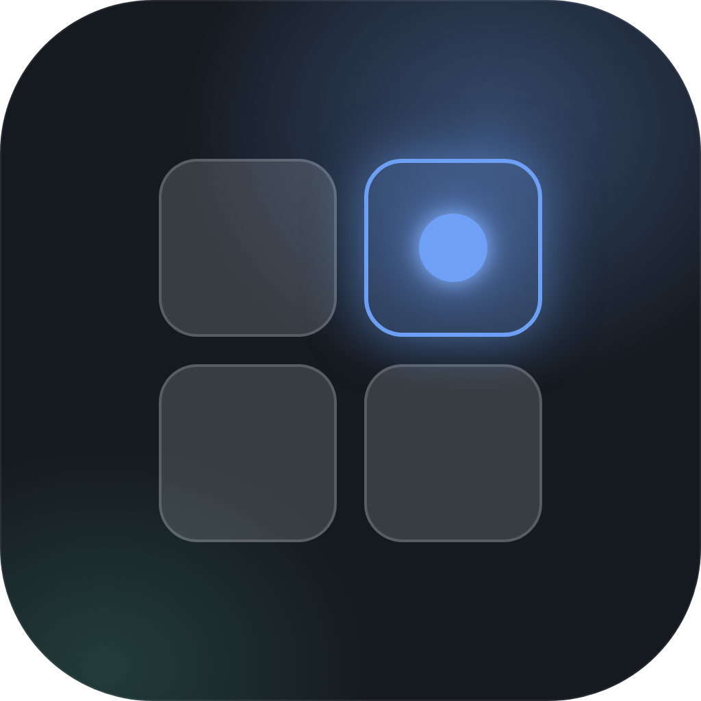
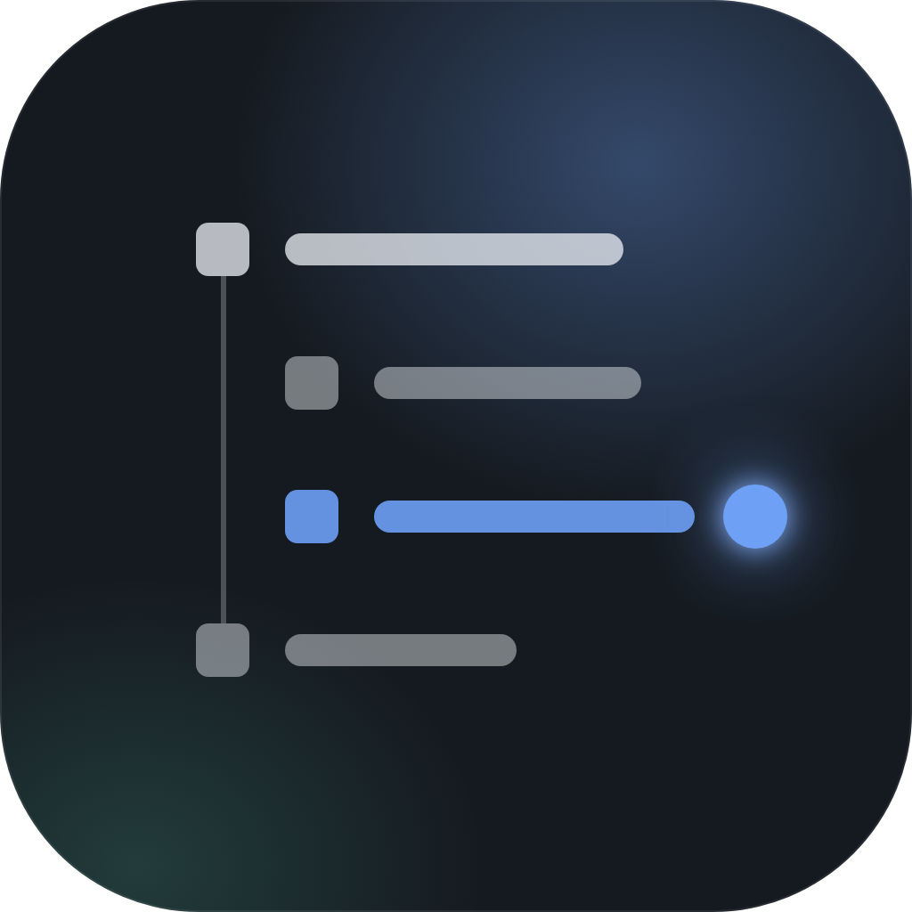

# Clarity

**Clarity for Claude Desktop**: a theme and three plugins, built for getting work done.
Legible text, status colors you can't misread, surfaces that stay calm over a long
session, and tools that stay quiet until something needs you.

[](docs/clarity-launch.mp4)

<sub>▶ [Watch the 41-second tour](docs/clarity-launch.mp4): real footage of a Claude Desktop session with Clarity installed.</sub>

| A test fails | Every file Claude touched | Risky commands ask first |
| --- | --- | --- |
|  |  |  |

## Install everything in one command

```bash
npx github:swperb/clarity
```

A picker opens with every plugin and the Clarity theme checked (pick Neon Noir instead
if you like; only one theme paints). Press Enter to install, or uncheck what you
don't want first (↑/↓ or j/k move, space toggles, `a` all, `n` none). Then start a new
session in Claude Desktop.

**Change your picks later** with the same picker. It shows what's installed; unchecking
disables a plugin (its data is kept), checking turns it back on:

```bash
npx github:swperb/clarity config
```

For scripts and dotfiles:

```bash
npx github:swperb/clarity --all --yes
```

```bash
npx github:swperb/clarity --only clarity-theme,workbench --scope project
```

`--list` shows what's available and installed, `--dry-run` prints the `claude plugin`
commands without running them, and `--remove` uninstalls what you uncheck instead of
disabling it.

**Update** everything you have installed to the latest release:

```bash
npx github:swperb/clarity update
```

**Uninstall** every Clarity plugin and the marketplace:

```bash
npx github:swperb/clarity uninstall
```

**Platforms:** **macOS** and **Windows**. Linux is [on the roadmap](#roadmap).

**Requirements:** Clarity is made for **Claude Desktop** (the Code tab), kept up to date.
The one-command installer also needs Node 18+ and the `claude` command on your PATH,
which it uses to install the plugins; it has no dependencies of its own. No `claude`
command? Use the in-app route below.

## What's in the suite

| | | What it's for |
| --- | --- | --- |
|  | [**Clarity theme**](themes/clarity-theme) | High legibility, colorblind-safe status colors, standard diff colors, strong keyboard focus rings. Light and dark. |
|  | [**Neon Noir**](themes/neon-noir) | A night city in the rain: blue-black surfaces, electric cyan and hot magenta accents, a quiet animated skyline along the top of the window. The same readability rules as Clarity's theme. Dark and light. |
|  | [**Workbench**](plugins/workbench) | An attention band for failing tests, uncommitted work and a filling context window; a guard that asks before hard-to-undo commands; a changed-files pane; a usage chip that explains time, cost and context when clicked. |
|  | [**Factory**](plugins/factory) | One control room for many sessions across many projects: a factory-floor pane, a needs-you queue with one batched notification, a per-project color tint, a radar for two sessions editing the same file, and **Home**, a briefing of what every session did, asked and spent while you were away, which opens itself after 20 quiet minutes. |
|  | [**Studio**](plugins/studio) | A soft IDE beside the chat: the session folder's file tree and a live viewer that follows what Claude reads, edits, searches and runs, with an activity strip. |

Each plugin also has its own in-session settings, for example `/workbench guard off` or `/studio auto off`. Factory's Home has a plugin setting too: how long you're away before it opens itself (default 20 minutes, or off).

## Works with any theme

Prefer someone else's theme? Install it next to Clarity's plugins and they adapt to it:

- **Workbench, Factory and Studio** draw with the app's meaning-based colors (success,
  error, warning, diff green and red), so they take whatever colors your theme gives
  those meanings.
- **Factory's project tint** is laid over your theme and changes only its accent. Your
  surfaces, text, backdrop and diff colors stay as they are, and `/factory tint off`
  restores your theme exactly.
- **The Clarity theme** steps aside when another theme plugin is installed, so the two
  never take turns replacing each other.

## Privacy

Clarity makes **no network requests**. Everything stays on your machine:

- **Workbench** and **Studio** run `git status` in your project to show branch and
  uncommitted work, and read the results of the tools Claude already runs.
- **Factory** writes one small status file per session to `~/.claude/factory/sessions/`
  (project folder, branch, state, the first line of your latest prompt, cost and context
  use) so its pane can show all your sessions, and removes files for sessions that have
  ended. For Home it keeps a week-long journal per session in `~/.claude/factory/journal/`
  (a line per finished task, the questions Claude asked, what held it up, commits and
  pushes, cost) and when you were last active in `~/.claude/factory/presence.json`. It
  raises local notifications only.
- The **themes** only set colors (and Neon Noir draws its backdrop scene).

## Install one at a time

In Claude Desktop, click **+** next to the prompt box → **Plugins** → **Add marketplace**
and enter `swperb/clarity`. Then add the plugins you want: `clarity-theme` or `neon-noir`, `workbench`,
`factory`, `studio`. Start a new session to load them.

## Roadmap

- **Linux.** Clarity works on macOS and Windows today; Linux support is planned.

## What every theme here must do

Looking good is the easy part. A theme in this repo also has to:

1. **Keep words readable.** Primary text at 7:1 contrast or better on every surface;
   muted text at 4.5:1 or better.
2. **Keep meaning.** Danger reads as red, success as green, warning as amber, and they
   stay distinguishable for people with color-vision deficiency (differ in lightness,
   not just hue).
3. **Leave diffs alone.** Added/removed lines keep the app's standard green and red:
   everyone reads them instantly, so a theme doesn't override `git` colors.
4. **Work in both light and dark**, unless the idea only makes sense in one.
5. **Not trip the app's own checks.** `makeColors` reports contrast problems; no line
   may start with `Desktop won't paint`, or the app ignores the theme.

## Add a theme or plugin

1. Copy `themes/clarity-theme` (or `plugins/workbench`) to a new folder and rename it in its `.claude-plugin/plugin.json`.
2. For a theme, edit the colors in `hooks/palette.js` and leave `make-colors.js` as it is.
   Check contrast: `node -e "import('./themes/<your-theme>/hooks/palette.js').then(m => console.log(m.clarity().problems.join('\n')))"`
3. Validate: `claude plugin validate <folder>`
4. Add an entry to `.claude-plugin/marketplace.json` and a row to the table above.
   The installer picks up new entries on its own.
5. Run the installer's tests: `npm test`.

## License

MIT
